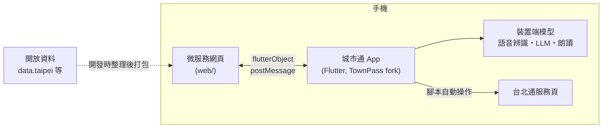

# TPE_Codefest2026

> 2026 臺北秋季程式設計節 · 城市通微服務大黑客松 參賽作品
>
> 一句話說明：看不清楚、手不方便的市民，用「說的」就能讓台北通聽懂需求、自動完成市政服務的查詢與繳費——語音辨識與 AI 理解全程在手機上完成。

## 目錄

- [需求與使用情境](#需求與使用情境)
- [主要功能](#主要功能)
- [系統架構](#系統架構)
- [Repo 結構](#repo-結構)
- [建置與執行](#建置與執行)
- [部署](#部署)
- [資料來源](#資料來源)
- [第三方套件](#第三方套件)
- [AI 使用聲明](#ai-使用聲明)
- [授權](#授權)
- [團隊成員](#團隊成員)

## 需求與使用情境

- **目標使用者：** 高齡者、視力退化、手部操作不便的市民與其照顧者（競賽主題「用不了」#身體限制）。
- **使用情境：** 長輩想查繳路邊停車費、查圖書館館藏、看臨櫃叫號進度，但看不清楚小字、不會在表單中切換欄位，或手抖難以精準點擊。
- **解決的問題：** 把台北通既有服務的操作旅程轉成「語音優先、大字體、步驟化」：使用者說出需求，AI 在裝置端理解並代為逐步操作，每一步朗讀並顯示，關鍵動作（付款）複誦金額、親口確認才執行。

## 主要功能

1. **語音理解（裝置端 LLM）**：Gemma 4 E2B 在手機上將口語需求轉成任務與關鍵字（如車號），離線可用；LLM 不可用時自動降級為關鍵字比對。
2. **腳本自動操作**：AI 依預先寫好的腳本開啟台北通服務頁，自動選車種、填車號、查詢、讀結果，每一步先朗讀再操作，畫面有「AI 操作中」浮層與停止鈕。
3. **兩段式安全繳費**：查詢後唸出金額 → 問「要現在幫您繳費嗎？」→ 補繳費方式 → 複誦「用○○繳△△共 X 元」→ 使用者說「對」才執行（示範站為模擬付款）；登入、驗證一律由使用者本人完成。
4. **規定問答**：停車費、借閱等常見規定打包進網頁（附官方出處），關閉網路也能用語音問答。
5. **無障礙設計**：大字體高對比、全程字幕（聽障可用）、觸控目標 48×48、語音不可用時的大按鈕備案。

## 系統架構



使用者用說的提出需求，手機上的 LLM 理解後挑選預先寫好的腳本，自動操作台北通裡的服務。語音辨識、LLM 推論與語音朗讀都在手機上執行，不使用後端。詳細設計見 [docs/系統設計文件.md](docs/系統設計文件.md)。

## Repo 結構

本作品由兩個 repo 組成：

| Repo | 內容 |
| --- | --- |
| [jsyang0322/TPE_Codefest2026](https://github.com/jsyang0322/TPE_Codefest2026)（本 repo） | 微服務網頁、設計文件 |
| [jsyang0322/TownPass](https://github.com/jsyang0322/TownPass) | fork 自 [taipei-doit/TownPass](https://github.com/taipei-doit/TownPass)，加入本服務的 App 端修改 |

```
TPE_Codefest2026/
├─ web/        微服務網頁（在城市通 WebView 中執行）
├─ docs/       系統設計文件、Demo 腳本
├─ AGENTS.md   AI 工具共用的專案說明與競賽規則
└─ LICENSE     AGPL-3.0
```

## 建置與執行

### 環境需求

| 項目 | 版本 |
| --- | --- |
| Flutter | 3.47.6（以 FVM 依 `.fvmrc` 安裝） |
| Dart SDK | 3.13 以上 |
| Java | 17（Android 建置） |
| iOS | 最低 iOS 15，需 Mac 與 Xcode |
| Node.js | 22 LTS |

### 1. 城市通 App（TownPass fork）

```bash
git clone https://github.com/jsyang0322/TownPass.git
cd TownPass
fvm install
fvm flutter pub get
fvm dart run build_runner build --delete-conflicting-outputs
fvm flutter run
```

App 開啟後，進入「服務 › 更多」，將本服務加入「我的服務」。

### 2. 微服務網頁

```bash
cd web
npm install
npm run dev        # 開發伺服器（--host，可供手機連入測試）
npm test           # 單元測試（node --test）
npm run build      # vue-tsc 檢查 + vite build
```

瀏覽器沒有 `flutterObject` 時自動使用 mock（語音改文字輸入、腳本僅列出步驟），可在桌機完整走過對話流程。

### 環境變數

本專案目前不需要任何環境變數或金鑰：前端無後端 API，LLM 推論在裝置端，FAQ 資料於建置時打包。

## 部署

| 元件 | 平台 | 網址 |
| --- | --- | --- |
| 微服務網頁 | Firebase Hosting | <https://tpe-codefest2026.web.app>（正式）；開發期使用 preview channel |

```bash
cd web && npm run build && firebase deploy --only hosting
```

## 資料來源

核心資料皆為合法開放資料；標示「模擬」者為非核心的模擬資料。

| 資料集名稱 | 提供機關 | 連結 | 用途 | 類型 |
| --- | --- | --- | --- | --- |
| 路邊停車費繳費規定（期限、管道、催繳、優惠） | 臺北市停車管理工程處 | <https://pma.gov.taipei> | 規定問答（任務 B），打包於 `web/src/data/faq/parking_fee.json` | 開放資料（政府網站公開資訊） |
| 圖書借閱規定（冊數、借期、續借、逾期、預約） | 臺北市立圖書館 | <https://tpml.gov.taipei> | 規定問答（任務 B），打包於 `web/src/data/faq/library.json` | 開放資料（政府網站公開資訊） |
| 台北通客服、1999 市民當家熱線 | 臺北市政府 | <https://id.taipei/tpcd> | 規定問答（任務 B），打包於 `web/src/data/faq/townpass.json` | 開放資料（政府網站公開資訊） |
| 臺北市各區戶政事務所等候人數（取用名稱、地址、電話） | 臺北市政府民政局 | <https://data.taipei/dataset/detail?id=3b9856c9-d26b-4089-95ad-bc4c5908461e> | 規定問答（任務 B），打包於 `web/src/data/faq/household_registration.json` | 開放資料（data.taipei，政府資料開放授權條款第 1 版） |
| 停車費、圖書借閱、臨櫃叫號服務頁內容 | 官方示範服務站（台北通開源專案） | <https://taipei-pass-service.vercel.app> | 腳本自動操作的對象 | 模擬（官方假資料） |
| 使用者個資（姓名、電話等） | TownPass `assets/mock_data/account.json` | — | 腳本代填基本資料 | 模擬（App 內建假資料） |

## 第三方套件

僅使用開源、免費的套件，不使用 Google Maps 等商用地圖或付費服務。

| 套件 | 版本 | 授權 | 用途 | 使用位置 |
| --- | --- | --- | --- | --- |
| Vue | 3.5 | MIT | 前端框架 | web |
| Pinia | 4.1 | MIT | 狀態管理 | web |
| Tailwind CSS | 4.3 | MIT | 樣式 | web |
| Vite / vue-tsc / TypeScript | 8.0 / 3.3 / 5.9 | MIT | 建置與型別檢查 | web |
| flutter_edge_ai | 2.5.6 | MIT | 裝置端 LLM 推論介面 | App |
| flutter_edge_ai_litertlm | 1.19.2 | MIT | LiteRT-LM 推論引擎（.litertlm） | App |
| speech_to_text | 7.5.0 | BSD-3-Clause | 裝置端語音辨識 | App |
| flutter_tts | 4.2.5 | MIT | 語音朗讀（系統語音，離線可用） | App |
| flutter_inappwebview | 6.1.5 | Apache-2.0 | WebView 與腳本注入（TownPass 既有） | App |

## AI 使用聲明

### 開發階段

本作品於開發階段使用以下雲端 AI 工具協助企劃、撰寫程式、除錯與整理資料：

- Claude（Anthropic，含 Claude Code）：系統設計、程式撰寫、code review、FAQ 資料整理
- <!-- 其他組員使用的 AI 工具請自行補充 -->

### 執行階段（裝置端模型揭露）

作品執行時的 LLM 推論完全在裝置端完成，不呼叫任何雲端模型 API 或遠端推論服務。

| 項目 | 內容 |
| --- | --- |
| 模型名稱 | Gemma 4 E2B（instruction-tuned） |
| 版本 | flutter_edge_ai 模型目錄之 `gemma4E2bIt`（generic 變體） |
| 量化格式 | `.litertlm`（LiteRT-LM 格式） |
| 推論框架 | LiteRT-LM（flutter_edge_ai 2.5.6 + flutter_edge_ai_litertlm 1.19.2） |
| 模型授權 | Apache-2.0 |
| 模型來源 | flutter_edge_ai 官方模型目錄，實際檔案為 Hugging Face [`litert-community/gemma-4-E2B-it-litert-lm`](https://huggingface.co/litert-community/gemma-4-E2B-it-litert-lm) 的 `gemma-4-E2B-it.litertlm`（revision `b3ca0d2`，約 2.6 GB；首次啟動時下載，或 demo 前預載） |

語音辨識（speech_to_text，強制 on-device）與語音合成（flutter_tts，系統語音）亦全程於裝置端執行。

## 授權

本 repo 以 [GNU Affero General Public License v3.0](LICENSE) 授權，並依競賽須知第捌條附上授權聲明（見 [LICENSE](LICENSE) 開頭）。

TownPass fork 沿用上游 [taipei-doit/TownPass](https://github.com/taipei-doit/TownPass) 的 GPL-3.0 授權。

## 團隊成員

| 姓名 | 角色 | GitHub |
| --- | --- | --- |
| <!-- TODO --> | | |
