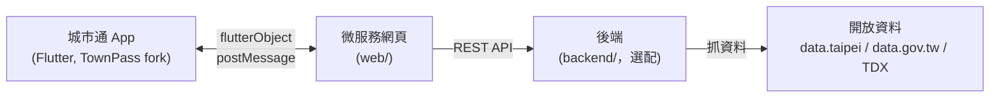

# TPE_Codefest2026

> 2026 臺北秋季程式設計節 · 城市通微服務大黑客松 參賽作品
>
> 一句話說明：<!-- TODO：題目公布後，用一句話說清楚這個服務解決什麼問題 -->

## 目錄

- [需求與使用情境](#需求與使用情境)
- [主要功能](#主要功能)
- [系統架構](#系統架構)
- [Repo 結構](#repo-結構)
- [建置與執行](#建置與執行)
- [部署](#部署)
- [資料來源](#資料來源)
- [第三方套件](#第三方套件)
- [AI 使用聲明](#ai-使用聲明)
- [授權](#授權)
- [團隊成員](#團隊成員)

## 需求與使用情境

<!-- TODO：誰、在什麼時候、為了什麼使用這個服務；對應的民眾聲音 -->

- **目標使用者：**
- **使用情境：**
- **解決的問題：**

## 主要功能

1. <!-- TODO -->
2.
3.

## 系統架構



<!-- TODO：確定技術選型後更新架構圖 -->

## Repo 結構

本作品由兩個 repo 組成：

| Repo | 內容 |
| --- | --- |
| [justin0322-pixel/TPE_Codefest2026](https://github.com/justin0322-pixel/TPE_Codefest2026)（本 repo） | 微服務網頁、後端 |
| [justin0322-pixel/TownPass](https://github.com/justin0322-pixel/TownPass) | fork 自 [taipei-doit/TownPass](https://github.com/taipei-doit/TownPass)，加入本服務的 App 端修改 |

```
TPE_Codefest2026/
├─ web/        微服務網頁（在城市通 WebView 中執行）
├─ backend/    後端 API（選配，附 Dockerfile）
├─ AGENTS.md   AI 工具共用的專案說明與競賽規則
└─ LICENSE     AGPL-3.0
```

## 建置與執行

### 環境需求

| 項目 | 版本 |
| --- | --- |
| Flutter | 3.47.6（以 FVM 依 `.fvmrc` 安裝） |
| Dart SDK | 3.13 以上 |
| Java | 17（Android 建置） |
| iOS | 最低 iOS 15，需 Mac 與 Xcode |
| Node.js | <!-- TODO --> |

### 1. 城市通 App（TownPass fork）

```bash
git clone https://github.com/justin0322-pixel/TownPass.git
cd TownPass
fvm install
fvm flutter pub get
fvm dart run build_runner build --delete-conflicting-outputs
fvm flutter run
```

App 開啟後，進入「服務 › 更多」，將本服務加入「我的服務」。

### 2. 微服務網頁

```bash
cd web
# TODO：安裝與啟動指令
```

### 3. 後端（選配）

```bash
cd backend
# TODO：安裝與啟動指令
```

### 環境變數

| 名稱 | 用途 | 範例 |
| --- | --- | --- |
| <!-- TODO --> | | |

## 部署

| 元件 | 平台 | 網址 |
| --- | --- | --- |
| 微服務網頁 | Firebase Hosting | <!-- TODO：https://xxx.web.app --> |
| 後端 API | Cloud Run（asia-east1） | <!-- TODO：https://xxx.asia-east1.run.app --> |

```bash
# 前端
cd web && npm run build && firebase deploy --only hosting

# 後端
cd backend && gcloud run deploy <service-name> --source . --region asia-east1
```

## 資料來源

核心資料皆為合法開放資料；標示「模擬」者為非核心的模擬資料。

| 資料集名稱 | 提供機關 | 連結 | 用途 | 類型 |
| --- | --- | --- | --- | --- |
| <!-- TODO --> | | | | 開放資料／模擬 |

## 第三方套件

僅使用開源、免費的套件，不使用 Google Maps 等商用地圖或付費服務。

| 套件 | 版本 | 授權 | 用途 | 使用位置 |
| --- | --- | --- | --- | --- |
| <!-- TODO --> | | | | web／backend／App |

## AI 使用聲明

### 開發階段

本作品於開發階段使用以下雲端 AI 工具協助企劃、撰寫程式、除錯與整理資料：

- <!-- TODO：例如 Claude Code -->

### 執行階段（裝置端模型揭露）

<!-- 若作品沒有 LLM 功能，請保留此句並刪除下表：本作品執行時未使用任何 LLM。 -->

作品執行時的 LLM 推論完全在裝置端完成，不呼叫任何雲端模型 API 或遠端推論服務。

| 項目 | 內容 |
| --- | --- |
| 模型名稱 | |
| 版本 | |
| 量化格式 | |
| 推論框架 | |
| 模型來源 | |
| 模型授權 | |

## 授權

本 repo 以 [GNU Affero General Public License v3.0](LICENSE) 授權，並依競賽須知第捌條附上授權聲明（見 [LICENSE](LICENSE) 開頭）。

TownPass fork 沿用上游 [taipei-doit/TownPass](https://github.com/taipei-doit/TownPass) 的 GPL-3.0 授權。

## 團隊成員

| 姓名 | 角色 | GitHub |
| --- | --- | --- |
| <!-- TODO --> | | |
