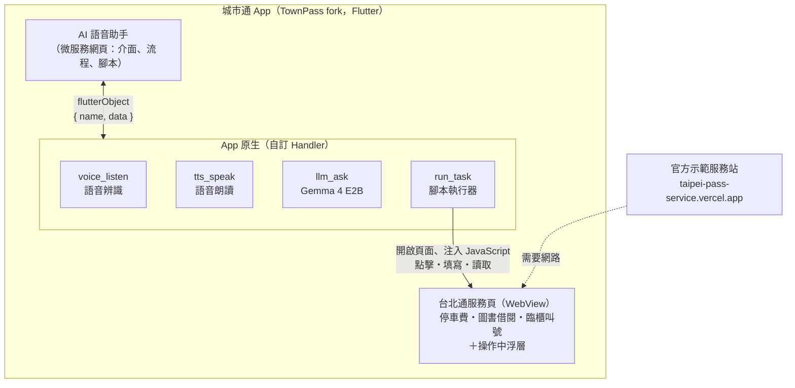
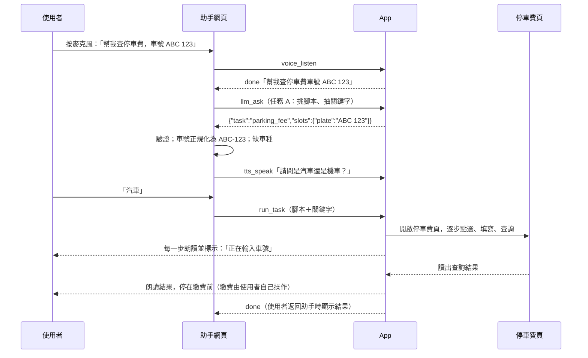

# 台北通 AI 語音助手——系統設計文件 v3

> 城市通微服務大黑客松 2026｜主題「用不了」#身體限制
>
> v3（2026/11/7 下午）：使用者用說的提出需求，手機上的 LLM 理解後挑選預先寫好的腳本，由腳本自動操作台北通裡的服務完成目標。

## 版本變更

### v2 → v3

| 項目 | v2 | v3 |
| --- | --- | --- |
| 助手完成需求的方式 | 在我們自己做的模擬表單上自動填寫 | 執行預先寫好的腳本，自動操作台北通裡的服務 |
| 主 demo | 敬老卡申請 | 停車費查詢；再加圖書館查書、臨櫃叫號 |
| LLM 的工作 | 意圖分類、規定問答 | 挑選腳本並抽出關鍵字、規定問答 |
| 新增元件 | — | `run_task` 訊息、App 端腳本執行器、操作中浮層 |
| 離線標準 | 進入服務後全程離線 | LLM（聽懂需求、回答問題）離線可用；開啟服務頁需要網路，和平常使用台北通一樣 |

### v1 → v2

| 項目 | v1 | v2 起 | 原因 |
| --- | --- | --- | --- |
| 語音辨識 | 網頁錄音 → 後端 → Whisper API | App 原生語音辨識（強制在裝置端） | 推論須在裝置端完成 |
| 對話理解 | 後端 LLM function calling + LangGraph | 手機上的 Gemma 4 E2B；流程由網頁的狀態機控制 | 同上；2B 小模型做 function calling 不穩 |
| 語音朗讀 | OpenAI TTS → 網頁 `<audio>` | App 原生 TTS（flutter_tts） | 同上；也避開 WebView 的自動播放限制 |
| 規定查詢 | 向量資料庫 RAG | 規定全文直接放進 prompt | 資料量小，不需要 embedding 模型 |
| 後端 | FastAPI | 不需要 | 少一次部署、少一個故障點 |
| Demo 裝置 | 實機或模擬器 | 實機（Android 8 GB RAM 以上＋iPhone） | 模擬器跑不動裝置端模型 |

---

## 一、競賽規則對設計的限制

AI agent、LLM、程式自動操作都可以做。限制只有一條：**模型推論在手機上執行**。

| 可以 | 不行 |
| --- | --- |
| 手機上的 LLM（Gemma 等） | 呼叫 OpenAI、Claude、Gemini 等雲端模型 API |
| 腳本自動點選、填寫、讀取台北通服務頁 | 自己架伺服器跑模型 |
| 一般後端（登入、資料庫、同步） | 把使用者輸入送到後端做推論 |
| 開發時用雲端 AI 寫程式、整理資料 | 大陸廠牌的模型或 AI 工具（例如 Qwen、DeepSeek） |

評審可能在**關閉網路**的狀態下現場出題，驗證 LLM 功能。設計標準：**關網路時，助手仍能聽懂需求、回答規定問題**；需要開啟服務頁時，說明目前沒有網路。

腳本操作的對象是台北通裡的服務頁，也就是官方示範服務站（`taipei-pass-service.vercel.app`），資料都是官方準備的假資料。不操作真正的市府系統，也不代為登入。付款只在示範站上模擬，而且要先複誦金額、使用者親口確認才執行（見第四節安全規則）。

依據：官方《2026 城市通入門指引》第 02、06 章、競賽須知（115.08.27 版）AI 使用規範；摘要見 [AGENTS.md](../AGENTS.md)。

---

## 二、系統架構

```
使用者說話 → 語音辨識 → LLM 理解需求、挑選腳本 → 腳本自動操作台北通服務 → 念出結果
```

**入口：** 使用者在台北通「服務」頁點「AI 語音助手」，開啟我們的微服務網頁。這個網頁顯示在 App 的 WebView 裡，外觀和 App 一致。這是官方指引建議的架構：網頁負責介面與流程，App 負責原生能力與裝置端模型。



一次查詢的流程：



### 關鍵設計決策

1. **推論全在手機。** 網頁不呼叫任何 AI 服務；語音辨識、LLM、朗讀都由 App 的 Handler 處理。
2. **入口是微服務網頁，原生能力在 App。** 語音走 App 原生，不走 WebView：WebView 裡的 `SpeechRecognition` 不可靠，`<audio>` 也有自動播放限制。
3. **LLM 只做兩件事：** (a) 從腳本清單挑一個，並抽出需要的關鍵字，輸出固定格式的 JSON；(b) 根據資料回答自由提問。**LLM 不產生操作步驟。**
4. **腳本是開發時寫好的步驟清單**，放在網頁端，修改不用重新建置 App。App 只有一個通用的執行器，而且只開放白名單網域。
5. **腳本一律停在付款、送出、登入之前**，交還使用者自己操作。（兩段式繳費機制保留在程式中但已停用，見 `agent/index.ts` 的 followUpScripts。）
6. **操作過程看得到。** 服務頁上疊一層浮層（「AI 操作中」、字幕、停止按鈕）；每一步先朗讀，再標示正在操作的元素。
7. **LLM 離線可用。** 需要網路的只有開啟服務頁。問答資料打包進網頁，網頁不載入 CDN 字型或腳本。

---

## 三、Bridge 介面規格

### 通用格式

- 網頁送出：`window.flutterObject.postMessage(JSON.stringify({ name, data }))`
- App 回覆：`{ name, data }` 的 JSON 字串，從 `flutterObject` 的 `message` 事件收到（App 端由 `TPWebStringMessageReply` 包裝）。
- **同一個請求可以收到多次回覆。** Handler 的 `onReply` 可以重複呼叫，用來串流中間結果。
- 自訂訊息中需要回覆的請求，`data` 都帶 `id`（網頁產生），App 回覆時原樣帶回，用來對應請求。
- 回覆的 `data.status`：`partial`（中間結果）、`done`（完成）、`error`（失敗，附 `code`、`message`）。
- App 沒有對應的 Handler 時不會回覆，網頁端每個請求都要設逾時。

網頁端封裝（示意，僅適用於帶 `id` 的自訂訊息）：

```ts
// web/src/bridge/request.ts
let seq = 0;

export function request(name, data, { onPartial, timeoutMs = 30000 } = {}) {
  const id = String(++seq);
  return new Promise((resolve, reject) => {
    const cleanup = () => {
      clearTimeout(timer);
      window.flutterObject.removeEventListener('message', onMessage);
    };
    const onMessage = (event) => {
      const msg = JSON.parse(event.data);
      if (msg.name !== name || msg.data?.id !== id) return;
      if (msg.data.status === 'partial') return onPartial?.(msg.data);
      cleanup();
      msg.data.status === 'done' ? resolve(msg.data) : reject(msg.data);
    };
    const timer = setTimeout(() => {
      cleanup();
      reject({ status: 'error', code: 'timeout' });
    }, timeoutMs);
    window.flutterObject.addEventListener('message', onMessage);
    window.flutterObject.postMessage(JSON.stringify({ name, data: { ...data, id } }));
  });
}
```

### 自訂訊息（在 TownPass fork 新增）

#### `voice_listen`：語音辨識

| 方向 | data |
| --- | --- |
| 網頁 → App | `{ id, action: 'start', locale: 'zh-TW' }`；或 `{ action: 'stop' }` |
| App → 網頁 | `{ id, status: 'partial', text }`：說話中持續回傳 |
| | `{ id, status: 'done', text }`：使用者停頓後結束 |
| | `{ id, status: 'error', code, message }`，`code` 為 `permission`、`unavailable`、`no_speech` |

- 強制裝置端辨識（speech_to_text 的 on-device 選項）。裝置不支援繁中離線辨識時回 `unavailable`，**不可默默改用雲端辨識**。iOS 會強制 `requiresOnDeviceRecognition`；Android 只有在手機支援裝置端辨識時才保證不走雲端，demo 前要用飛航模式驗證。
- 停頓計時從開始聽就在算。長輩開口前常會想一下，所以開口前最多等 8 秒，聽到第一個字後改成停頓 3 秒就結束，實測後再調。
- 開始聽之前，App 會先停止正在念的話。上一次辨識還沒結束又收到新的 `start`，會先結束上一次再開始。
- 辨識結果的英數字可能帶空格，例如「車號A B C 123 」，網頁正規化時要先去掉空白。

#### `tts_speak`：語音朗讀

| 方向 | data |
| --- | --- |
| 網頁 → App | `{ id, text, rate? }`；或 `{ action: 'stop' }` |
| App → 網頁 | `{ id, status: 'done' }`：念完 |
| | `{ id, status: 'error', code, message }` |

- 語言 zh-TW。`rate` 在兩個平台都是 0.5 為正常語速，不帶時用 0.42（比一般慢）。
- 念到一半被 `{ action: 'stop' }` 或新的 `tts_speak` 中斷時，也回 `done`。
- iOS 使用 playback 音訊類別，手機切到靜音模式也念得出來。
- 開始聽之前，網頁先送 `stop`，避免 App 正在念的話被辨識進去（App 端也會再停一次）。

#### `llm_status`：模型狀態與預熱

| 方向 | data |
| --- | --- |
| 網頁 → App | `{ id }` |
| App → 網頁 | `{ id, status: 'done', state }`，`state` 為 `missing`（手機上沒有模型檔）、`loading`、`ready` |

- 收到時如果模型還沒載入，就開始載入（首次需數十秒）。網頁一打開就送一次，順便預熱。

#### `llm_ask`：裝置端 LLM

| 方向 | data |
| --- | --- |
| 網頁 → App | `{ id, system, prompt, maxTokens }`；或 `{ action: 'stop' }`（中止進行中的推論，不回覆） |
| App → 網頁 | `{ id, status: 'partial', text }`：目前為止的累積全文 |
| | `{ id, status: 'done', text }` |
| | `{ id, status: 'error', code, message }`，`code` 為 `not_ready`、`busy`、`failed` |

- **prompt 由網頁組好，App 只負責推論。** 改 prompt 不用重新建置 App；App 端維持通用，其他服務也能共用同一個模型。
- 一次只跑一個請求（手機記憶體有限），忙碌時回 `busy`。
- context window（prompt＋回覆）為 4096 token，見 TownPass `LlmService.contextWindowTokens`。
- `partial` 回傳累積全文而不是單一 token，網頁直接覆蓋顯示即可。

#### `run_task`：執行腳本

| 方向 | data |
| --- | --- |
| 網頁 → App | `{ id, script, slots }`；或 `{ action: 'stop' }` |
| App → 網頁 | `{ id, status: 'partial', step, say }`：每一步開始時回報一次；`say` 是這一步要念的話，沒有就是空字串 |
| | `{ id, status: 'done', result }`：`result` 以 `read` 步驟的 `as` 為 key，例如 `{ bills: [...] }` |
| | `{ id, status: 'error', code, step, message }`，`code` 為 `offline`、`not_allowed`、`step_failed`、`stopped` |

- App 收到後，在新的 WebView 頁面開啟腳本第一步的網址，逐步執行；每一步的 `say` 由 App 直接朗讀。
- 網頁送原始腳本和 `slots`，**`{plate}` 這類變數由 App 替換**，因為 `read` 讀到的值要執行時才知道。
- 腳本中任何 `open` 網址不是 https 或不在白名單內，就回 `not_allowed`。白名單先只開放 `taipei-pass-service.vercel.app`。執行期間，任務頁的主頁面也不能跳到白名單以外的網域。
- 開啟前先查一次網域的 DNS，查不到就回 `offline`，不開啟頁面，由網頁說明目前沒有網路。
- 執行期間助手網頁在背景，結果同時用語音念出；使用者返回助手網頁時，網頁依 `done` 的 `result` 顯示文字。網頁端的逾時要比腳本長（目前 180 秒）。
- `stopped`：使用者按了浮層的「停止」、關閉任務頁，或網頁送了 `{ action: 'stop' }`。正在等頁面上的動作時也會立刻中止，App 會念「好的，已經停止」。
- 同時只執行一個腳本；上一個還在執行時收到新的，會先停掉上一個。

### 使用的內建訊息

| name | 網頁送出的 data | 用途 |
| --- | --- | --- |
| `userinfo` | 無 | 取得 `realName`、`phoneNo` 等，作為腳本需要的個人資料 |
| `location` | 無 | 回答「附近的……」這類問題 |
| `open_link` | 網址字串 | 有網路時導向官方網站 |
| `1999agree` | 依官方文件 | LLM 答不出來時，引導撥打 1999 |

### 瀏覽器開發模式

`web/src/bridge/` 偵測不到 `window.flutterObject` 時改用 mock，讓網頁可以在桌機瀏覽器開發：

| 訊息 | mock 行為 |
| --- | --- |
| `voice_listen` | 畫面上的文字輸入框代替麥克風 |
| `tts_speak` | 只顯示字幕（可選用瀏覽器的 `speechSynthesis` 念出來） |
| `llm_status` | 直接回 `ready` |
| `llm_ask` | 依關鍵字回傳預設答案 |
| `run_task` | 在畫面上逐步列出腳本步驟，不真的操作 |
| `userinfo` | 回傳與 TownPass `account.json` 中 `data` 欄位相同格式的假資料 |

`runner.js`（見第四節）不需要 App 也能測試：在電腦瀏覽器打開示範服務站，從 DevTools Console 貼上執行即可。

---

## 四、對話流程

### 狀態機

```
待命 → 聆聽 → 理解（任務 A）─┬→ 補齊關鍵字（缺什麼問什麼）→ 執行腳本 → 念出結果 → 待命
                            ├→ 規定問答（任務 B）→ 待命
                            └→ 聽不懂 → 再問一次 → 第二次仍聽不懂：顯示任務大按鈕

任何時候：說「停止」或按停止按鈕 → 中止腳本
          說「再說一次」→ 重念上一句
```

| 狀態 | 助手說什麼（例） | 判斷方式 |
| --- | --- | --- |
| 待命 | 「您好，請按下面的大按鈕，告訴我您想做什麼。」 | — |
| 理解 | — | LLM 任務 A；LLM 不可用時改用任務關鍵字 |
| 補齊關鍵字 | 「請問是汽車還是機車？」 | 關鍵字比對、車號正規化 |
| 執行腳本 | 「好的，我幫您查車號 ABC-123 的停車費。」 | 程式（`run_task`） |
| 念出結果 | 「查到的停車費已經列在畫面上……要繳費請按畫面上的按鈕。」 | 程式 |

### 判斷使用者說的話

- **自由口語**（待命時說的需求）：先用關鍵字判斷，判斷不了才問 LLM 任務 A。手機上的 LLM 每次都要先讀完整段 prompt，常見說法用關鍵字就能確定，不用等（`routeByKeywords()`，`web/src/agent/keywords.ts`）：
  1. 有腳本關鍵字＋要辦事的說法（幫我、我要、我想…），而且不是「問、知道」→ 腳本。例：「可以幫我查停車費嗎」
  2. 像問句 → 直接走任務 B（不經過任務 A）。例：「停車費要怎麼繳」「圖書館幾點關門」
  3. 有腳本關鍵字 → 腳本。例：「停車費」「區公所現在叫到幾號」
  4. 都不是 → 任務 A（最多等 15 秒，`maxTokens` 80）。逾時或輸出驗證失敗時請使用者再說一次。

  走關鍵字時，選項（汽車／機車、機關）、車號、書名也由網頁從句子裡抽（`slotsFromText()`）；抽不到就之後再問。任務 B 只放和問題相關的 FAQ（`pickFaqs()`）。等 LLM 超過 2 秒，先念「好的，我想一下」，畫面顯示已經等了幾秒。
- **簡短回答**（是／不是、汽車／機車、停止）：先用關鍵字規則（`web/src/agent/keywords.ts`），比對不到再問 LLM。「不是」包含「是」，所以**先比對否定詞**：
  - 否定：不、不是、不要、錯了
  - 肯定：對、是、好、沒錯、可以、要
  - 停止：停止、不要了、取消
  - 重複：再說一次、聽不清楚
- 兩種方式都失敗：請使用者再說一次；第二次仍失敗，就顯示任務大按鈕讓使用者點選。

### LLM 任務

**任務 A：挑選腳本、抽出關鍵字。** 任務清單由腳本的 `id`、`description`、`slots` 自動產生，新增腳本時 prompt 會跟著更新。

```
system：
你是臺北市政府城市通的語音助手。從下列任務中選出最符合使用者需求的一個，並抽出需要的資料。只輸出 JSON，不要輸出其他文字。
任務：
- parking_fee：查詢路邊停車費。資料：vehicle（汽車或機車）、plate（車號）
- library_search：在圖書館查書。資料：keyword（書名或作者）
- counter_calling：查詢臨櫃叫號進度。資料：office（機關名稱）
- question：詢問規定或其他問題
- other：以上都不是
格式：{"task": "...", "slots": {...}, "question": "task 為 question 時，填使用者的問題"}
使用者沒提到的資料不要填。

prompt：
使用者說：「{語音辨識結果}」
```

網頁端驗證：可以 `JSON.parse`；`task` 在清單內；`slots` 只能有該腳本定義的欄位。格式不符的欄位視為沒說，進入「補齊關鍵字」。

**任務 B：規定問答。** 只根據提供的資料回答。

```
system：
你是臺北市政府城市通的語音助手，對象是長輩與行動不便的市民。只根據下面的資料回答，使用繁體中文（臺灣用語），兩句話以內，口語化，不要條列。
資料裡沒有的內容，回答「這個我不確定，可以幫您撥 1999 詢問」。
資料：
{web/src/data/faq/ 的內容}

prompt：
{使用者的問題}
```

- 回答會被念出來，所以要短；`maxTokens` 先設 150。
- 評審關網路出題時會問自由問題。資料準備時，每個腳本對應的服務都要收常見問題，例如停車費的繳費方式與期限、圖書借閱規則。
- 小模型偶爾會輸出簡體字；prompt 已要求繁體，實測若仍常出現，再評估加字詞轉換。

### 任務腳本與自動操作

**腳本格式**（`web/src/agent/scripts/<id>.json`，示意；按鈕文字與結果區塊要 PoC 時實際檢查頁面才能確定）：

```json
{
  "id": "parking_fee",
  "description": "查詢路邊停車費",
  "slots": {
    "vehicle": { "ask": "請問是汽車還是機車？", "options": ["汽車", "機車"] },
    "plate": { "ask": "請說車號，例如 ABC 1234。", "pattern": "^[A-Z0-9]{2,4}-[A-Z0-9]{2,4}$" }
  },
  "steps": [
    { "open": "https://taipei-pass-service.vercel.app/fee-payment/detail/fee-5/" },
    { "say": "正在幫您查詢停車費" },
    { "click": { "text": "{vehicle}" } },
    { "fill": { "near": "AAA-8888", "value": "{plate}" }, "say": "輸入車號 {plate}" },
    { "click": { "text": "查詢" } },
    { "read": { "selector": "<結果區塊，PoC 時確認>", "as": "bills" } },
    { "stop": "查到的停車費已經列在畫面上。要繳費，請按畫面上的繳費按鈕。" }
  ]
}
```

| 步驟 | 參數 | 作用 |
| --- | --- | --- |
| `open` | 網址 | 開啟服務頁（只限白名單網域） |
| `click` | 定位方式 | 點擊元素 |
| `fill` | 定位方式、`value` | 填入文字，並觸發 `input`、`change` 事件（Vue 才會更新畫面資料） |
| `read` | 定位方式、`as`；可加 `all`（回傳陣列，查無資料時為 `[]`）、`pairs`（把「標籤｜值」兩欄解析成物件） | 讀出文字，存成變數給後面的步驟使用，也放進 `done` 的 `result` |
| `wait` | 定位方式 | 只等元素出現，不操作（例如等換頁完成） |
| `say` | 文字 | 朗讀 |
| `stop` | 文字 | 朗讀後結束，把畫面交還使用者 |

- 腳本可以有 `next`：`{ "script": "parking_fee_pay", "when": "bills", "ask": "要現在幫您繳費嗎？", "confirm": "用{method}繳車號 {plate} 的停車費，共 {total} 元，確定嗎？" }`。結果裡 `when` 指的欄位是非空陣列才接著問；`{total}` 這類摘要值由 `agent/describe.ts` 的 `resultVars()` 算出（見 `agent/followup.ts`）。
- 每一步都可以附 `say`，在執行前朗讀。`{plate}` 這類寫法會換成關鍵字或 `read` 讀到的值。
- **定位方式**：`text`（畫面上看得到的文字，優先使用）、`near`（某段文字旁邊的輸入框）、`selector`（CSS selector，前兩種找不到時才用）。示範服務站不是我們寫的，CSS class 可能變動，盡量用文字定位。共用選項：`index`（第幾個符合的元素）、`timeoutMs`（預設 8000）。

**執行器**（App 端）：

- `assets/task_runner/runner.js`：注入服務頁，負責等待、定位、點擊、填寫、讀取、標示。成功回 `{ ok: true, value }`，失敗回 `{ ok: false, code, message }`，不丟例外。完整的步驟格式寫在檔案開頭的註解。
- `lib/service/task_runner_service.dart`：逐步執行腳本。`open`、`say`、`stop` 由 Dart 處理；`click`、`fill`、`read`、`wait` 透過 `callAsyncJavaScript` 交給 runner.js。
- **每一個頁面步驟前都注入一次 runner.js**，不只在 `onLoadStop` 時注入：示範服務站是 Vue 單頁應用，按「查詢」換頁不一定會觸發 `onLoadStop`。runner.js 會檢查版本，重複注入不會重複定義。
- 每一步先等目標元素出現（最多 8 秒），因為頁面載入完成時，Vue 的畫面可能還沒畫好。
- 每一步先念 `say`，再操作。操作前把目標元素加粗框標示，停約 0.8 秒再動作，讓使用者跟得上。不用閃爍效果（無障礙規範）。
- 任何一步失敗就停止執行，朗讀「這一步沒有成功，頁面已經打開，您可以自己接著操作」，並回覆 `step_failed`。
- **浮層**（`lib/util/tp_task_overlay.dart`）：服務頁上方固定顯示「AI 操作中」與目前步驟的字幕，底部是全寬、高 64 的「停止」按鈕。執行結束後浮層收起，頁面交還使用者。
- 任務頁用 `Get.toNamed(..., preventDuplicates: false)` 開啟：助手網頁本身也是 `webView` 路由，GetX 預設會擋掉重複的路由。

**安全規則：**

- LLM 只能選腳本、填關鍵字，不能產生步驟。
- 執行器只開放白名單網域：開啟前檢查腳本的每個 `open` 網址，執行期間攔下跳到其他網域的導覽（`shouldOverrideUrlLoading`）。
- **腳本一律停在付款、送出、登入之前**，交還使用者自己操作（團隊決策：AI 不碰繳費功能）。兩段式繳費機制（`next` 欄位、複誦確認）保留在程式與測試中但已停用；重新啟用只需把 `agent/index.ts` 的 followUpScripts 解除註解。

**demo 腳本清單：**

| 腳本 | 服務頁 | 關鍵字 | 優先 |
| --- | --- | --- | --- |
| `parking_fee` | `/fee-payment/detail/fee-5/`（停車費） | 車種、車號 | P0 |
| `parking_fee_pay`（**已停用**，機制保留） | 同上 → 全部繳清 → … → 繳費完成 | 車種、車號、繳費方式 | — |
| `library_search` | `/library-service/`（圖書借閱） | 書名或作者 | P1 |
| `counter_calling` | `/counter-calling/`（臨櫃叫號） | 機關 | P1 |

- 步驟由 5 號在示範服務站實際操作一遍後整理。可以用 `npx playwright codegen <網址>` 錄製操作，自動找出要點的文字和欄位；4 號再寫成腳本。
- 示範服務站停車費假資料的車號是 `ABC-123`，demo 時用這個車號。

**車號正規化**（`web/src/agent/normalize.ts`）：轉大寫、去掉空白、中文數字轉阿拉伯數字（「一二三」→「123」）、在英文和數字的分界補上連字號。正規化後符合 `pattern` 才使用。說過的車號存在手機上，下次直接確認「是 ABC-123 嗎？」

---

## 五、模型與套件

| 用途 | 套件／模型 | 授權 | 備註 |
| --- | --- | --- | --- |
| 裝置端 LLM 推論 | flutter_edge_ai（原 flutter_gemma） | MIT | 官方指引推薦；LiteRT-LM 引擎；指引撰寫時版本 2.3.2 |
| LLM 模型 | Gemma 4 E2B（`.litertlm`） | Apache-2.0 | 官方指引推薦；8 GB RAM 的手機較穩 |
| 備案推論框架 | llamadart（GGUF） | MIT | flutter_edge_ai 跑不起來時改用；指引撰寫時版本 0.8.19 |
| 語音辨識 | speech_to_text 7.5.0 | BSD-3-Clause | 強制裝置端辨識 |
| 語音朗讀 | flutter_tts 4.2.5 | MIT | 系統語音，離線可用 |
| 腳本執行 | flutter_inappwebview（TownPass 既有） | Apache-2.0 | 不需新增套件 |
| 前端 | Vue 3、Vite、Pinia、Tailwind CSS | MIT | 框架不限，官方範例採用 Vue 3 |
| 開發工具（不打包進作品） | Playwright（codegen 錄製） | Apache-2.0 | 錄製示範服務站的操作步驟 |

### 模型檔

- 不 commit。本 repo 的 `.gitignore` 已排除 `.litertlm`、`.gguf` 等；TownPass fork 的 `.gitignore` 還沒有，要補上。
- Demo 前預先放進手機（adb push 或檔案 App），或在 App 首次啟動時下載。下載需要網路，要在 demo 前完成。
- 首次載入需數十秒，網頁開啟時送 `llm_status` 預熱。
- PoC 確定後，把模型名稱、版本、量化格式、推論框架、來源填進 README 的「執行階段（裝置端模型揭露）」。

---

## 六、資料

| 資料 | 來源 | 類型 | 狀態 |
| --- | --- | --- | --- |
| 停車費、圖書、叫號等服務內容 | 官方示範服務站（台北通內建服務） | 模擬（官方假資料） | 已確認 |
| 各服務的常見問題與規定 | 臺北市停車管理工程處、臺北市立圖書館、臺北市政府網站 | 開放資料（政府網站公開資訊） | 已整理（`parking_fee.json`、`library.json`、`townpass.json`） |
| 臺北市各區戶政事務所（名稱、地址、電話） | data.taipei「臺北市各區戶政事務所等候人數」（民政局，政府資料開放授權條款第 1 版） | 開放資料 | 已整理（`household_registration.json`） |
| 使用者個資 | TownPass `assets/mock_data/account.json` | 模擬（App 內建假資料） | — |

- **規則要求核心資料是合法開放資料。** 示範服務站的內容是假資料，所以至少要有一個 data.taipei 的資料集。目前用的是戶政事務所資料集，對應臨櫃叫號腳本，回答「中山區戶政事務所在哪裡」這類問題。
- 任務 B 會把所有問答資料放進 prompt，資料越多，手機推論越慢、也越容易超過 context window（App 端設 4096）。所以不放館舍數多的資料集（例如圖書館各分館有 70 筆）；要加的話，先改成依問題挑選相關的檔案。
- 開發時把資料抓好，轉成 `web/src/data/faq/*.json`，執行時不呼叫 API。每個檔案附 `source`、`url`、`retrievedAt` 欄位，README「資料來源」表照著填。

---

## 七、專案結構

本作品由兩個 repo 組成（見 [README](../README.md#repo-結構)）。

### 本 repo（TPE_Codefest2026）

```
TPE_Codefest2026/
├─ web/                     微服務網頁（Vue 3 + Vite）
│  └─ src/
│     ├─ bridge/            flutterObject 封裝、瀏覽器 mock
│     ├─ agent/             狀態機、關鍵字規則、prompt、LLM 輸出驗證、車號正規化
│     │  └─ scripts/        任務腳本 JSON
│     ├─ data/              問答資料 JSON（附出處）
│     ├─ stores/            Pinia：對話紀錄、任務狀態
│     └─ views/             主畫面、任務進度、結果
├─ docs/                    本文件、開發流程與分工
├─ AGENTS.md
└─ README.md
```

### TownPass fork 的修改

| 檔案 | 修改內容 |
| --- | --- |
| `pubspec.yaml` | 加入 flutter_edge_ai、speech_to_text、flutter_tts；assets 加 `assets/task_runner/` |
| `lib/service/llm_service.dart`（新） | 載入模型一次，提供串流產生文字的 `generate()`；在 `main.dart` 用 `Get.put` 註冊，收到第一次 `llm_status` 才載入模型 |
| `lib/service/speech_service.dart`（新） | 包裝語音辨識與朗讀 |
| `lib/service/task_runner_service.dart`（新） | 逐步執行腳本、朗讀、回報進度 |
| `assets/task_runner/runner.js`（新） | 注入服務頁的 JavaScript |
| `lib/util/tp_web_view.dart` | `WebViewArgument` 加上 `runsTask` 欄位；為 true 時把 WebView 交給執行器、疊上操作中浮層，並在執行期間攔下跳出白名單的導覽。非 release 版允許 Safari Web Inspector 檢查 WebView |
| `lib/util/tp_task_overlay.dart`（新） | 操作中浮層；頁面關閉時停止執行 |
| `lib/util/web_message_handler/voice_message_handler.dart`（新） | `voice_listen`、`tts_speak` |
| `lib/util/web_message_handler/llm_message_handler.dart`（新） | `llm_status`、`llm_ask` |
| `lib/util/web_message_handler/task_message_handler.dart`（新） | `run_task`：檢查白名單、開啟頁面、轉交執行器 |
| `lib/util/web_message_handler/tp_web_message_listener.dart` | 把新 Handler 加進 `_cachedMessageHandlers` |
| `lib/page/city_service/model/my_service_model.dart` | 新增 `MyServiceItemId.voiceAgent` 與對應的 `MyServiceItem` |
| `lib/page/city_service/widget/pinned_service_widget_controller.dart` | 把 `voiceAgent` 放進預設的「我的服務」（這份清單只存在記憶體，App 重開就回到預設） |
| `assets/svg/icon_voice_agent.svg`（新） | 服務圖示；加入後執行 `fvm dart run build_runner build --delete-conflicting-outputs` |
| `android/app/src/main/AndroidManifest.xml` | 加 `RECORD_AUDIO`、`INTERNET`（原本只在 debug／profile 的 manifest，release 版會連不上網頁）；`<queries>` 加 RecognitionService 與 TTS_SERVICE |
| `ios/Runner/Info.plist` | 加 `NSMicrophoneUsageDescription`、`NSSpeechRecognitionUsageDescription` |
| `.gitignore` | 加 `*.litertlm`、`*.gguf`、`*.task` |

Android `minSdk` 與 iOS deployment target 依 flutter_edge_ai 的 README 調整。

服務註冊：

```dart
MyServiceItemId.voiceAgent => MyServiceItem(
    title: 'AI 語音助手',
    description: '用說的辦市政服務',
    icon: Assets.svg.iconVoiceAgent.svg(),
    category: MyServiceCategory.cityService,
    destinationUrl: 'https://<firebase-project>.web.app',
    forceWebViewTitle: 'AI 語音助手',
  ),
```

`llm_ask` Handler（示意；`LlmService` 是我們自己包的 service）：

```dart
class LlmAskMessageHandler extends TPWebMessageHandler {
  @override
  String get name => 'llm_ask';

  @override
  Future<void> handle({
    required Object? message,
    required WebUri? sourceOrigin,
    required bool isMainFrame,
    required Function(WebMessage reply)? onReply,
  }) async {
    final Map data = message as Map;
    final String id = data['id'];
    final LlmService llm = Get.find<LlmService>();

    if (!llm.isReady || llm.isBusy) {
      onReply?.call(replyWebMessage(data: {
        'id': id,
        'status': 'error',
        'code': llm.isReady ? 'busy' : 'not_ready',
      }));
      return;
    }

    String text = '';
    try {
      await for (final String chunk in llm.generate(
        system: data['system'],
        prompt: data['prompt'],
        maxTokens: data['maxTokens'] ?? 150,
      )) {
        text += chunk;
        onReply?.call(replyWebMessage(data: {'id': id, 'status': 'partial', 'text': text}));
      }
      onReply?.call(replyWebMessage(data: {'id': id, 'status': 'done', 'text': text}));
    } catch (error) {
      onReply?.call(replyWebMessage(data: {
        'id': id,
        'status': 'error',
        'code': 'failed',
        'message': error.toString(),
      }));
    }
  }
}
```

執行器呼叫 runner.js 的方式（示意）：

```dart
final CallAsyncJavaScriptResult? result = await controller.callAsyncJavaScript(
  functionBody: 'return await window.__tpRunner.run(step);',
  arguments: {'step': step},
);
if (result?.error != null) {
  // 停止執行，朗讀失敗說明，回覆 step_failed
}
```

### 開發時在 App 內測試網頁

- 網頁功能先在桌機瀏覽器用 mock 開發。
- 要在 App 內測試時，用 Firebase Hosting 的預覽頻道（`firebase hosting:channel:deploy dev`）取得 HTTPS 網址，填進 `destinationUrl`。這樣不用處理 http 的 cleartext 設定。
- 不用等網頁也能測 Handler：在 App 裡隨便開一個服務頁（例如「申辦服務」），用 Safari「開發」選單連到 iPhone 上的 WebView（iPhone 要開「設定 › App › Safari › 進階 › 網頁檢查器」），在主控台貼：

  ```js
  flutterObject.addEventListener('message', (e) => console.log(e.data));
  flutterObject.postMessage(JSON.stringify({ name: 'tts_speak', data: { id: '1', text: '您好' } }));
  ```

- iOS debug 版只能由 `flutter run` 或 Xcode 啟動，斷線後從主畫面打不開；要測飛航模式或離開電腦測試，改用 `fvm flutter run --profile`。

---

## 八、開發環境

| 項目 | 版本／需求 |
| --- | --- |
| Flutter | 3.47.6（用 FVM，依 `.fvmrc`） |
| Dart SDK | 3.13 以上 |
| Java | 17（Android 建置） |
| Xcode | iOS 建置需 Mac，最低 iOS 15 |
| Node.js | 22 LTS |
| 實機 | Android 8 GB RAM 以上；iPhone 建議 15 Pro 之後的機型（8 GB RAM）。兩支都要能離線辨識繁體中文 |

---

## 九、開發順序與分工

人員分配、時程與 Git 流程見 [開發流程與分工](開發流程與分工.md)。

### PoC（開賽後最先做，依風險排序）

| # | 驗證項目 | 通過標準 | 失敗時的備案 |
| --- | --- | --- | --- |
| 1 | 在 fork 加 `llm_status`／`llm_ask`，用 flutter_edge_ai + Gemma 4 E2B，實機開飛航模式測試 | 網頁送出繁中需求後，幾秒內回傳正確的任務 JSON | 換量化程度更高的版本、縮短 prompt；再不行改用 llamadart + GGUF |
| 2 | `voice_listen`，飛航模式下辨識繁體中文 | 長輩的語速與口語能正確辨識 | 試 Gemma 的音訊輸入（flutter_edge_ai 標示支援多模態，尚未驗證音訊）；再不行改用大按鈕 |
| 3 | 腳本執行：App 開啟停車費頁，注入 JavaScript 自動選車種、填車號、按查詢 | 兩個平台都能自動完成查詢 | 只開啟頁面，改用語音逐步引導使用者自己操作 |
| 4 | `tts_speak`，飛航模式 | 中文朗讀正常 | iOS 通常沒問題；Android 先下載離線語音資料 |
| 5 | 網頁在瀏覽器用 mock 開發，再進 App 串接 | 完整走完一次流程 | — |

**第一天 17:00 檢查點決定範圍：**

- 全部通過 → 完整流程：語音 → LLM 挑腳本 → 自動操作。
- 1 不通過 → 改用任務關鍵字挑腳本（「停車」→ 停車費查詢），自動操作照樣能展示；問答改成常見問題按鈕。官方指引也提到「沒有 AI 功能也能做出好作品」。
- 2 不通過 → 大按鈕選任務，車號用按鈕或鍵盤輸入；保留朗讀與自動操作。
- 3 不通過 → 只開啟服務頁，用語音一步一步引導使用者自己操作。

### 模組

| 模組 | 內容 | 依賴 |
| --- | --- | --- |
| A. App 原生 | `llm_*`、`voice_listen`、`tts_speak`、`run_task` 執行器與浮層、權限、服務註冊 | PoC 1–4 |
| B. 網頁介面 | 主畫面、字幕、任務進度與結果、bridge 與 mock | — |
| C. 對話與腳本 | 狀態機、prompt、輸出驗證、車號正規化、腳本 JSON、runner.js | 示範服務站的操作步驟 |
| D. 資料 | 問答資料、核心開放資料集、操作步驟紀錄 | — |
| E. 整合與 demo | 實機端到端測試、飛航模式測試、README、demo 腳本 | 全部 |

---

## 十、Demo 前測試清單

- [ ] 每個腳本在兩支手機、兩個平台都能自動跑完
- [ ] demo 前一小時，把所有腳本在示範服務站上再跑一次，確認頁面沒有改版
- [ ] 腳本執行中按「停止」能立即中止
- [ ] 關網路：說出需求，助手能聽懂並回答規定問題；要開服務頁時會說明沒有網路
- [ ] 有網路：完整走完 demo 流程
- [ ] 模型已預熱，第一句不用等數十秒
- [ ] 模擬評審自由提問 10 題，記錄回答品質與等待時間
- [ ] 開著 VoiceOver／TalkBack 走一次（螢幕閱讀器會和我們的朗讀同時發聲）
- [ ] 系統字級放大 200% 仍可閱讀，觸控目標至少 48×48
- [ ] 「聆聽中／思考中／說話中／操作中」都有文字＋聲音提示，不用閃爍動畫
- [ ] 所有朗讀內容都有字幕（聽障者也能使用）
- [ ] 在吵雜環境（比賽會場）測辨識率
- [ ] 網頁不載入任何外部字型或 CDN 腳本

---

## 十一、Demo 腳本

### 初選（約 2 分鐘，投影實機畫面，不用簡報）

| 時間 | 內容 |
| --- | --- |
| 0:00 | 題目：看不清楚、手不方便的人，用說的就能讓台北通自己完成操作 |
| 0:15 | 情境：一位手部不便的長輩想查停車費 |
| 0:30 | 實機：服務頁點「AI 語音助手」→「幫我查停車費，車號 ABC 123」→ 助手問「汽車還是機車？」→「汽車」→ 台北通自動開啟停車費頁，一步一步選車種、填車號、查詢（畫面上看得到每一步）→ 念出「查到 N 筆共 X 元」，停在繳費前、請使用者自己按繳費 → 有時間再示範第二個腳本（圖書館查書） |
| 1:40 | 資料來源與技術：Gemma 4 E2B 在手機上理解需求、挑選腳本，App 注入腳本操作服務頁；資料來源 |

實機段約 70 秒。每輪「辨識 → 推論 → 朗讀」需要數秒，腳本每步也有約 1 秒的停頓，第一個腳本要完整演完，第二個視時間決定。

### 決選（約 5 分鐘＋問答）

- 在初選內容之外，示範第二、三個腳本。
- 開飛航模式讓評審現場出題，展示 LLM 離線也能聽懂需求、回答問題。
- 說明安全設計：LLM 只能選腳本、執行器只開放白名單網域、腳本停在付款前（AI 不碰繳費）、登入一律由使用者本人完成。

收尾：「市府開放更多服務後，只要新增腳本，同一個助手就能幫忙操作。」

---

## 十二、繳交前同步

- README：架構圖、Repo 結構、第三方套件表、資料來源表、裝置端模型揭露。
- 本 repo 與 TownPass fork 都設為公開。
- 不 commit 模型檔與 `.env`。

---

## 參考資源

| 資源 | 連結 |
| --- | --- |
| 官方開發文件（雙向通訊、設計規範、無障礙） | <https://tpe-guideline.web.app> |
| App 內建方法清單 | <https://tpe-guideline.web.app/en/docs/two-way-connection/app_method.html> |
| TownPass 原始碼 | <https://github.com/taipei-doit/TownPass> |
| 本隊 TownPass fork | <https://github.com/jsyang0322/TownPass> |
| 官方示範服務站（腳本操作的對象） | <https://taipei-pass-service.vercel.app> |
| 競賽須知 | <https://codefest.taipei/2026-fall> |
| 臺北市資料大平臺 | <https://data.taipei> |
| 往屆整併作品 | `taipei-doit/townpass2024-parking`、`taipei-doit/townpass2025-RideFlow`、`taipei-doit/townpass2024-weather` |
