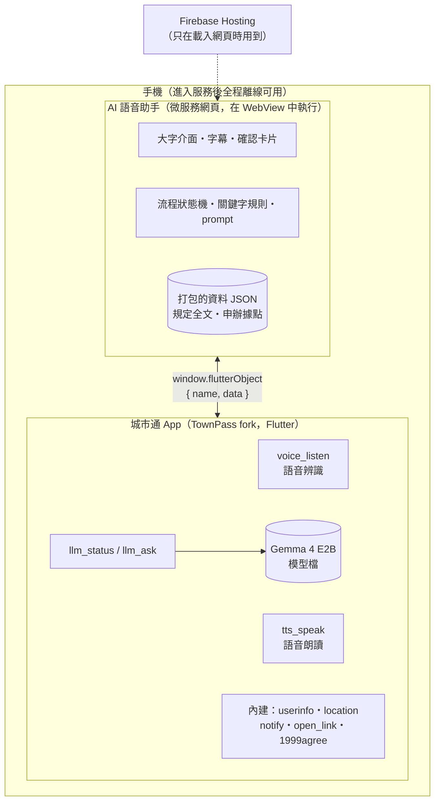
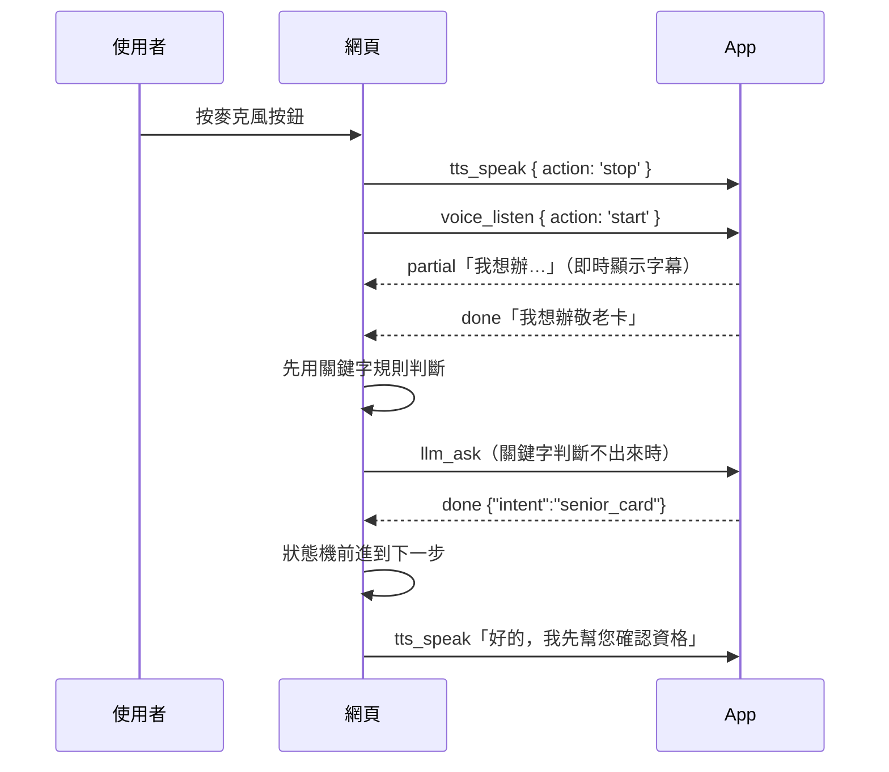

# 台北通 AI 語音助手——系統設計文件 v2

> 城市通微服務大黑客松 2026｜主題「用不了」#身體限制
>
> v2（2026/11/7）：依競賽 AI 規則重新設計。所有 AI 推論改在手機上執行，進入服務後不需要網路。

## v1 → v2 變更摘要

| 項目 | v1 | v2 | 原因 |
| --- | --- | --- | --- |
| 語音辨識 | 網頁錄音 → 後端 → Whisper API | App 原生語音辨識（強制在裝置端） | 推論須在裝置端完成 |
| 對話理解 | 後端 LLM function calling + LangGraph | 手機上的 Gemma 4 E2B；流程由網頁的狀態機控制 | 同上；2B 小模型做 function calling 不穩 |
| 語音朗讀 | OpenAI TTS → 網頁 `<audio>` | App 原生 TTS（flutter_tts） | 同上；也避開 WebView 的自動播放限制 |
| 規定查詢 | 向量資料庫 RAG | 規定全文直接放進 prompt | 只 demo 1–2 項服務，不需要 embedding 模型 |
| 後端 | FastAPI | 不需要 | 執行時不連網；少一次部署、少一個故障點 |
| Demo 裝置 | 實機或模擬器 | 實機（Android 8 GB RAM 以上＋iPhone） | 模擬器跑不動裝置端模型 |

不變的部分：fork TownPass、以 WebView 載入微服務網頁的整合方式；工具白名單；送出前複誦確認；登入／OTP 由本人操作；模擬申辦＋`open_link` 收尾。

---

## 一、競賽規則對設計的限制

AI agent、LLM、程式自動操作都可以做。限制只有一條：**模型推論在手機上執行**。

| 可以 | 不行 |
| --- | --- |
| 手機上的 LLM（Gemma 等） | 呼叫 OpenAI、Claude、Gemini 等雲端模型 API |
| 程式自動填表、按下一步 | 自己架伺服器跑模型 |
| 一般後端（登入、資料庫、同步） | 把使用者輸入送到後端做推論 |
| 開發時用雲端 AI 寫程式、整理資料 | 大陸廠牌的模型或 AI 工具（例如 Qwen、DeepSeek） |

評審可能在**關閉網路**的狀態下現場出題。設計標準：**先進入服務，再開飛航模式，整個流程照常運作。**

程式能自動操作的是我們自己做的模擬表單，不能操作真正的市府網站或正式版台北通（有登入、OTP，也沒有開放 API）。

依據：官方《2026 城市通入門指引》第 06 章、競賽須知（115.08.27 版）AI 使用規範；摘要見 [AGENTS.md](../AGENTS.md)。

---

## 二、系統架構



一輪語音對話：



### 關鍵設計決策

1. **推論全在手機。** 網頁不呼叫任何 AI 服務；語音辨識、LLM、朗讀都由 App 的 Handler 處理。
2. **語音走 App 原生，不走 WebView。** WebView 裡的 `SpeechRecognition` 不可靠，`<audio>` 有自動播放限制；原生端沒有這兩個問題，也不用處理 WebView 的麥克風權限。
3. **流程由程式控制，LLM 只做兩件事：** (a) 把一句口語轉成固定格式的意圖 JSON；(b) 根據規定全文回答自由提問。下一步、填欄位、送出都由狀態機決定。
4. **送出前一定複誦確認。** 大字卡片＋語音朗讀，使用者說「對」或按按鈕才送出。
5. **執行時不連網。** 資料在建置時打包進網頁；不載入 CDN 字型或腳本。
6. **模擬申辦為主軸。** 有網路時可用 `open_link` 導向官方申辦入口，作為延伸展示。

---

## 三、Bridge 介面規格

### 通用格式

- 網頁送出：`window.flutterObject.postMessage(JSON.stringify({ name, data }))`
- App 回覆：`{ name, data }` 的 JSON 字串，從 `flutterObject` 的 `message` 事件收到（App 端由 `TPWebStringMessageReply` 包裝）。
- **同一個請求可以收到多次回覆。** Handler 的 `onReply` 可以重複呼叫，用來串流中間結果。
- 自訂訊息中需要回覆的請求，`data` 都帶 `id`（網頁產生），App 回覆時原樣帶回，用來對應請求。
- 回覆的 `data.status`：`partial`（中間結果）、`done`（完成）、`error`（失敗，附 `code`、`message`）。
- App 沒有對應的 Handler 時不會回覆，網頁端每個請求都要設逾時。

網頁端封裝（示意，僅適用於帶 `id` 的自訂訊息）：

```ts
// web/src/bridge/request.ts
let seq = 0;

export function request(name, data, { onPartial, timeoutMs = 30000 } = {}) {
  const id = String(++seq);
  return new Promise((resolve, reject) => {
    const cleanup = () => {
      clearTimeout(timer);
      window.flutterObject.removeEventListener('message', onMessage);
    };
    const onMessage = (event) => {
      const msg = JSON.parse(event.data);
      if (msg.name !== name || msg.data?.id !== id) return;
      if (msg.data.status === 'partial') return onPartial?.(msg.data);
      cleanup();
      msg.data.status === 'done' ? resolve(msg.data) : reject(msg.data);
    };
    const timer = setTimeout(() => {
      cleanup();
      reject({ status: 'error', code: 'timeout' });
    }, timeoutMs);
    window.flutterObject.addEventListener('message', onMessage);
    window.flutterObject.postMessage(JSON.stringify({ name, data: { ...data, id } }));
  });
}
```

### 自訂訊息（在 TownPass fork 新增）

#### `voice_listen`：語音辨識

| 方向 | data |
| --- | --- |
| 網頁 → App | `{ id, action: 'start', locale: 'zh-TW' }`；或 `{ action: 'stop' }` |
| App → 網頁 | `{ id, status: 'partial', text }`：說話中持續回傳 |
| | `{ id, status: 'done', text }`：使用者停頓後結束 |
| | `{ id, status: 'error', code, message }`，`code` 為 `permission`、`unavailable`、`no_speech` |

- 強制裝置端辨識（speech_to_text 的 on-device 選項）。裝置不支援繁中離線辨識時回 `unavailable`，**不可默默改用雲端辨識**。
- 長輩說話停頓較長，停頓判定先設 3 秒，實測後再調。

#### `tts_speak`：語音朗讀

| 方向 | data |
| --- | --- |
| 網頁 → App | `{ id, text, rate? }`；或 `{ action: 'stop' }` |
| App → 網頁 | `{ id, status: 'done' }`：念完 |
| | `{ id, status: 'error', code, message }` |

- 語言 zh-TW，預設語速比一般慢，網頁可傳 `rate` 調整。
- 開始聽之前，網頁先送 `stop`，避免 App 正在念的話被辨識進去。

#### `llm_status`：模型狀態與預熱

| 方向 | data |
| --- | --- |
| 網頁 → App | `{ id }` |
| App → 網頁 | `{ id, status: 'done', state }`，`state` 為 `missing`（手機上沒有模型檔）、`loading`、`ready` |

- 收到時如果模型還沒載入，就開始載入（首次需數十秒）。網頁一打開就送一次，順便預熱。

#### `llm_ask`：裝置端 LLM

| 方向 | data |
| --- | --- |
| 網頁 → App | `{ id, system, prompt, maxTokens }` |
| App → 網頁 | `{ id, status: 'partial', text }`：目前為止的累積全文 |
| | `{ id, status: 'done', text }` |
| | `{ id, status: 'error', code, message }`，`code` 為 `not_ready`、`busy`、`failed` |

- **prompt 由網頁組好，App 只負責推論。** 改 prompt 不用重新建置 App；App 端維持通用，其他服務也能共用同一個模型。
- 一次只跑一個請求（手機記憶體有限），忙碌時回 `busy`。
- `partial` 回傳累積全文而不是單一 token，網頁直接覆蓋顯示即可。

### 使用的內建訊息

| name | 網頁送出的 data | 用途 |
| --- | --- | --- |
| `userinfo` | 無 | 取得 `realName`、`idNo`、`birthday`、`phoneNo`、`residentAddress`、`citizen`（是否設籍臺北）、`nativePeople`，用來代填表單與判斷資格 |
| `location` | 無 | 取得座標，找最近的申辦據點 |
| `notify` | `{ title, content }` | 模擬送出後推播通知 |
| `open_link` | 網址字串 | 有網路時導向官方申辦入口 |
| `1999agree` | 依官方文件 | LLM 答不出來時，引導撥打 1999 |

`notify` 的 `content` 不要出現「已訂閱」「已取消訂閱」字樣，App 會把它當成訂閱操作（見 `NotifyMessageHandler`）。

### 瀏覽器開發模式

`web/src/bridge/` 偵測不到 `window.flutterObject` 時改用 mock，讓網頁可以在桌機瀏覽器開發：

| 訊息 | mock 行為 |
| --- | --- |
| `voice_listen` | 畫面上的文字輸入框代替麥克風 |
| `tts_speak` | 只顯示字幕（可選用瀏覽器的 `speechSynthesis` 念出來） |
| `llm_status` | 直接回 `ready` |
| `llm_ask` | 依關鍵字回傳預設答案 |
| `userinfo` | 回傳與 TownPass `account.json` 中 `data` 欄位相同格式的假資料 |

---

## 四、對話流程（敬老卡 demo）

### 狀態機

```
歡迎 → 聽需求 → 資格確認 → 代填資料 → 複誦確認 → 送出（模擬）→ 完成
                   │                      │
                   └ 不符資格：說明原因，    └ 回答「不對」：回到代填，逐欄修改
                     提供撥打 1999

任何狀態：說「再說一次」→ 重念上一句
          問規定相關問題 → 進入規定問答，答完回到原本的狀態
```

| 狀態 | 助手說什麼（例） | 期待的回答 | 判斷方式 |
| --- | --- | --- | --- |
| 歡迎 | 「您好，請按下面的大按鈕，告訴我您想辦什麼。」 | 自由口語 | LLM 意圖分類 |
| 資格確認 | 依 `userinfo` 的生日、`citizen`、`nativePeople` 判斷，念出結果 | — | 程式判斷（門檻由資料組依社會局規定填入） |
| 代填資料 | 「我已經幫您填好姓名、生日和地址。」 | — | 程式 |
| 複誦確認 | 逐項念出；身分證字號只念末四碼 | 對／不對 | 關鍵字，判斷不出來再問 LLM |
| 送出 | 「申請已經送出。」並送 `notify` | — | 程式 |

### 判斷使用者回答的順序

1. **關鍵字規則**（`web/src/agent/keywords.ts`）。「不是」包含「是」，所以**先比對否定詞**：
   - 否定：不、不是、不要、錯了
   - 肯定：對、是、好、沒錯、可以、要
   - 重複：再說一次、聽不清楚
   - 取消：取消、不辦了、離開
2. 比對不到 → 送 `llm_ask`（任務 A）。
3. LLM 輸出驗證失敗 → 請使用者再說一次 → 第二次仍失敗，就顯示大按鈕讓使用者點選。

### LLM 任務

**任務 A：意圖分類。** 只列出當下狀態可用的意圖，要求輸出固定 JSON。

```
system：
你是臺北市政府城市通的語音助手。把使用者說的話分類成下列其中一個意圖，只輸出 JSON，不要輸出其他文字。
可用意圖：senior_card（申請敬老卡）、question（詢問規定）、other（其他）
格式：{"intent": "...", "question": "使用者的問題，intent 為 question 時才填"}

prompt：
使用者說：「{語音辨識結果}」
```

網頁端驗證：可以 `JSON.parse`，而且 `intent` 在允許清單內；否則視為失敗。

**任務 B：規定問答。** 只根據提供的資料回答。

```
system：
你是臺北市政府城市通的語音助手，對象是長輩。只根據下面的資料回答，使用繁體中文（臺灣用語），兩句話以內，口語化，不要條列。
資料裡沒有的內容，回答「這個我不確定，可以幫您撥 1999 詢問」。
資料：
{web/src/data/senior-card.json 的規定全文}

prompt：
{使用者的問題}
```

- 回答會被念出來，所以要短；`maxTokens` 先設 150。
- 評審關網路出題時會問自由問題。資料準備時多收幾項常見問題：申辦地點、應備文件、多久拿到卡、能用在哪些地方。
- 小模型偶爾會輸出簡體字；prompt 已要求繁體，實測若仍常出現，再評估加字詞轉換。

---

## 五、模型與套件

| 用途 | 套件／模型 | 授權 | 備註 |
| --- | --- | --- | --- |
| 裝置端 LLM 推論 | flutter_edge_ai（原 flutter_gemma） | MIT | 官方指引推薦；LiteRT-LM 引擎；指引撰寫時版本 2.3.2 |
| LLM 模型 | Gemma 4 E2B（`.litertlm`） | Apache-2.0 | 官方指引推薦；8 GB RAM 的手機較穩 |
| 備案推論框架 | llamadart（GGUF） | MIT | flutter_edge_ai 跑不起來時改用；指引撰寫時版本 0.8.19 |
| 語音辨識 | speech_to_text | 加入前到 pub.dev 確認 | 強制裝置端辨識 |
| 語音朗讀 | flutter_tts | 加入前到 pub.dev 確認 | 系統語音，離線可用 |
| 前端 | Vue 3、Vite、Pinia、Tailwind CSS | MIT | 框架不限，官方範例採用 Vue 3 |

### 模型檔

- 不 commit。本 repo 的 `.gitignore` 已排除 `.litertlm`、`.gguf` 等；TownPass fork 的 `.gitignore` 還沒有，要補上。
- Demo 前預先放進手機（adb push 或檔案 App），或在 App 首次啟動時下載。下載需要網路，要在 demo 前完成。
- 首次載入需數十秒，網頁開啟時送 `llm_status` 預熱。
- PoC 確定後，把模型名稱、版本、量化格式、推論框架、來源填進 README 的「執行階段（裝置端模型揭露）」。

---

## 六、資料

| 資料 | 來源 | 類型 | 狀態 |
| --- | --- | --- | --- |
| 敬老卡申請資格、應備文件、申辦方式 | 臺北市政府社會局網站 | 開放資料（需確認網站的資料開放宣告） | 待整理 |
| 申辦據點（區公所等） | data.taipei | 開放資料 | 待確認資料集 |
| 申辦表單、送出結果 | 自建 | 模擬 | — |
| 使用者個資 | TownPass `assets/mock_data/account.json` | 模擬（App 內建假資料） | — |

- 開發時把資料抓好，轉成 `web/src/data/*.json`，執行時不呼叫 API。每個檔案附 `source`、`url`、`retrievedAt` 欄位，README「資料來源」表照著填。
- **長者情境：** `account.json` 預設生日是 1988/12/12，不符合敬老卡資格。demo 前把 `birthday` 改成符合資格的日期；要展示非市民情境時改 `citizen: false`。
- **最近據點：** 用 `location` 取得座標，由程式計算距離，念出最近的三筆。不顯示地圖，因為 OpenStreetMap 圖磚需要網路，離線時會是空白。

---

## 七、專案結構

本作品由兩個 repo 組成（見 [README](../README.md#repo-結構)）。

### 本 repo（TPE_Codefest2026）

```
TPE_Codefest2026/
├─ web/                     微服務網頁（Vue 3 + Vite）
│  └─ src/
│     ├─ bridge/            flutterObject 封裝、瀏覽器 mock
│     ├─ agent/             狀態機、關鍵字規則、prompt、LLM 輸出驗證
│     ├─ data/              打包的開放資料 JSON（附出處）
│     ├─ stores/            Pinia：對話紀錄、申辦資料
│     └─ views/             主畫面、確認卡片、完成頁
├─ docs/                    本文件、Demo 腳本
├─ AGENTS.md
└─ README.md
```

v2 不需要 `backend/`，README 的「系統架構」與「Repo 結構」要同步更新。

### TownPass fork 的修改

| 檔案 | 修改內容 |
| --- | --- |
| `pubspec.yaml` | 加入 flutter_edge_ai、speech_to_text、flutter_tts |
| `lib/service/llm_service.dart`（新） | 載入模型一次，提供串流產生文字的 `generate()`；在 `main.dart` 用 `Get.put` 註冊，收到第一次 `llm_status` 才載入模型 |
| `lib/service/speech_service.dart`（新） | 包裝語音辨識與朗讀 |
| `lib/util/web_message_handler/voice_message_handler.dart`（新） | `voice_listen`、`tts_speak` |
| `lib/util/web_message_handler/llm_message_handler.dart`（新） | `llm_status`、`llm_ask` |
| `lib/util/web_message_handler/tp_web_message_listener.dart` | 把新 Handler 加進 `_cachedMessageHandlers` |
| `lib/page/city_service/model/my_service_model.dart` | 新增 `MyServiceItemId.voiceAgent` 與對應的 `MyServiceItem` |
| `assets/svg/icon_voice_agent.svg`（新） | 服務圖示；加入後執行 `fvm dart run build_runner build --delete-conflicting-outputs` |
| `android/app/src/main/AndroidManifest.xml` | 加 `RECORD_AUDIO`；依 speech_to_text README 加 RecognitionService 的 `<queries>` |
| `ios/Runner/Info.plist` | 加 `NSMicrophoneUsageDescription`、`NSSpeechRecognitionUsageDescription` |
| `assets/mock_data/account.json` | demo 用的生日與身分 |
| `.gitignore` | 加 `*.litertlm`、`*.gguf`、`*.task` |

Android `minSdk` 與 iOS deployment target 依 flutter_edge_ai 的 README 調整。

服務註冊：

```dart
MyServiceItemId.voiceAgent => MyServiceItem(
    title: 'AI 語音助手',
    description: '用說的辦市政服務',
    icon: Assets.svg.iconVoiceAgent.svg(),
    category: MyServiceCategory.cityService,
    destinationUrl: 'https://<firebase-project>.web.app',
    forceWebViewTitle: 'AI 語音助手',
  ),
```

`llm_ask` Handler（示意；`LlmService` 是我們自己包的 service）：

```dart
class LlmAskMessageHandler extends TPWebMessageHandler {
  @override
  String get name => 'llm_ask';

  @override
  Future<void> handle({
    required Object? message,
    required WebUri? sourceOrigin,
    required bool isMainFrame,
    required Function(WebMessage reply)? onReply,
  }) async {
    final Map data = message as Map;
    final String id = data['id'];
    final LlmService llm = Get.find<LlmService>();

    if (!llm.isReady || llm.isBusy) {
      onReply?.call(replyWebMessage(data: {
        'id': id,
        'status': 'error',
        'code': llm.isReady ? 'busy' : 'not_ready',
      }));
      return;
    }

    String text = '';
    try {
      await for (final String chunk in llm.generate(
        system: data['system'],
        prompt: data['prompt'],
        maxTokens: data['maxTokens'] ?? 150,
      )) {
        text += chunk;
        onReply?.call(replyWebMessage(data: {'id': id, 'status': 'partial', 'text': text}));
      }
      onReply?.call(replyWebMessage(data: {'id': id, 'status': 'done', 'text': text}));
    } catch (error) {
      onReply?.call(replyWebMessage(data: {
        'id': id,
        'status': 'error',
        'code': 'failed',
        'message': error.toString(),
      }));
    }
  }
}
```

### 開發時在 App 內測試網頁

- 網頁功能先在桌機瀏覽器用 mock 開發。
- 要在 App 內測試時，用 Firebase Hosting 的預覽頻道（`firebase hosting:channel:deploy dev`）取得 HTTPS 網址，填進 `destinationUrl`。這樣不用處理 http 的 cleartext 設定。

---

## 八、開發環境

| 項目 | 版本／需求 |
| --- | --- |
| Flutter | 3.47.6（用 FVM，依 `.fvmrc`） |
| Dart SDK | 3.13 以上 |
| Java | 17（Android 建置） |
| Xcode | iOS 建置需 Mac，最低 iOS 15 |
| Node.js | 22 LTS |
| 實機 | Android 8 GB RAM 以上；iPhone 建議 15 Pro 之後的機型（8 GB RAM）。兩支都要能離線辨識繁體中文 |

---

## 九、開發順序與分工

### PoC（開賽後最先做，依風險排序）

| # | 驗證項目 | 通過標準 | 失敗時的備案 |
| --- | --- | --- | --- |
| 1 | 在 fork 加 `llm_status`／`llm_ask`，用 flutter_edge_ai + Gemma 4 E2B，實機開飛航模式測試 | 網頁送出繁中問題後，幾秒內開始出字 | 換量化程度更高的版本、縮短 prompt 與回答；再不行改用 llamadart + GGUF |
| 2 | `voice_listen`，飛航模式下辨識繁體中文 | 長輩的語速與口語能正確辨識 | 試 Gemma 的音訊輸入（flutter_edge_ai 標示支援多模態，尚未驗證音訊）；再不行改用大按鈕點選 |
| 3 | `tts_speak`，飛航模式 | 中文朗讀正常 | iOS 通常沒問題；Android 先下載離線語音資料 |
| 4 | 網頁在瀏覽器用 mock 開發，再進 App 串接 | 完整走完一次流程 | — |

1、2 可以分給不同人同時做；網頁介面與資料整理可以和 1–3 同步進行。

**第一天結束前決定 AI 範圍：**

- 1、2、3 都通過 → 完整的語音助手。
- 1 不通過 → 拿掉 LLM：用關鍵字＋按鈕跑流程，保留語音辨識與朗讀。官方指引也提到「沒有 AI 功能也能做出好作品」。
- 2 不通過 → 改用大按鈕點選，保留朗讀與 LLM 問答（常見問題做成按鈕）。

### 模組分工

| 模組 | 內容 | 負責 | 依賴 |
| --- | --- | --- | --- |
| A. App Handler | `llm_*`、`voice_listen`、`tts_speak`、權限、服務註冊 | | PoC 1–3 |
| B. 網頁介面 | 大字介面、字幕、確認卡片、bridge 與 mock | | — |
| C. 對話流程 | 狀態機、關鍵字規則、prompt、LLM 輸出驗證 | | B 的 bridge 介面 |
| D. 資料 | 規定全文、申辦據點、出處 | | — |
| E. 整合與 demo | 實機端到端測試、飛航模式測試、README、demo 腳本 | | 全部 |

---

## 十、Demo 前測試清單

- [ ] 先進入服務再開飛航模式，完整走完流程（兩支手機、兩個平台）
- [ ] 模型已預熱，第一句不用等數十秒
- [ ] 模擬評審自由提問 10 題，記錄回答品質與等待時間
- [ ] 開著 VoiceOver／TalkBack 走一次（螢幕閱讀器會和我們的朗讀同時發聲）
- [ ] 系統字級放大 200% 仍可閱讀，觸控目標至少 48×48
- [ ] 「聆聽中／思考中／說話中」都有文字＋聲音提示，不用閃爍動畫
- [ ] 所有朗讀內容都有字幕（聽障者也能使用）
- [ ] 在吵雜環境（比賽會場）測辨識率
- [ ] 網頁不載入任何外部字型或 CDN 腳本

---

## 十一、Demo 腳本

### 初選（約 2 分鐘，投影實機畫面，不用簡報）

| 時間 | 內容 |
| --- | --- |
| 0:00 | 題目：看不清楚、打字不方便的長輩，用說的完成市政申辦 |
| 0:15 | 情境：一位 70 歲的長輩想辦敬老卡 |
| 0:30 | 實機：從城市通進入服務 → **開飛航模式，讓評審看到** →「我想辦敬老卡」→ 資格確認 → 複誦確認 →「對」→ 模擬送出＋推播通知 → 一題自由提問（例：「要帶什麼證件？」） |
| 1:40 | 資料來源與技術：社會局規定＋data.taipei；Gemma 4 E2B 在手機上執行，全程離線 |

實機段約 70 秒，每輪「辨識 → 推論 → 朗讀」在手機上需要數秒，對話排 3–4 輪就好。

### 決選（約 5 分鐘＋問答）

在初選內容之外，補上非市民情境（`citizen: false`，助手說明不符資格並提供撥打 1999），以及更多自由問答。

收尾：「同一套流程，未來市府開放 API 授權後，就能直接完成真實申辦。」

---

## 十二、繳交前同步

- README：架構圖、Repo 結構（拿掉 `backend/`）、第三方套件表、資料來源表、裝置端模型揭露。
- 本 repo 與 TownPass fork 都設為公開。
- 不 commit 模型檔與 `.env`。

---

## 參考資源

| 資源 | 連結 |
| --- | --- |
| 官方開發文件（雙向通訊、設計規範、無障礙） | <https://tpe-guideline.web.app> |
| App 內建方法清單 | <https://tpe-guideline.web.app/en/docs/two-way-connection/app_method.html> |
| TownPass 原始碼 | <https://github.com/taipei-doit/TownPass> |
| 本隊 TownPass fork | <https://github.com/jsyang0322/TownPass> |
| 競賽須知 | <https://codefest.taipei/2026-fall> |
| 臺北市資料大平臺 | <https://data.taipei> |
| 往屆整併作品 | `taipei-doit/townpass2024-parking`、`taipei-doit/townpass2025-RideFlow`、`taipei-doit/townpass2024-weather` |
